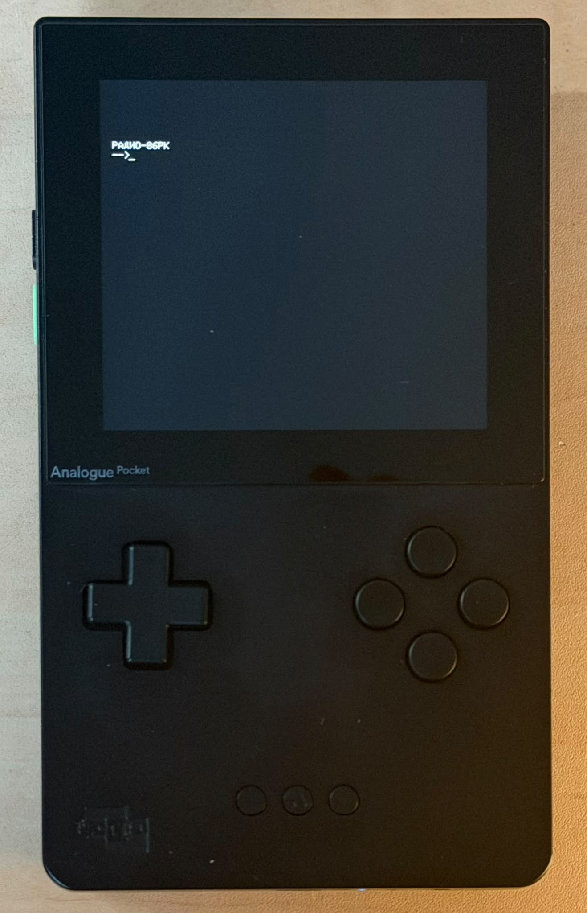
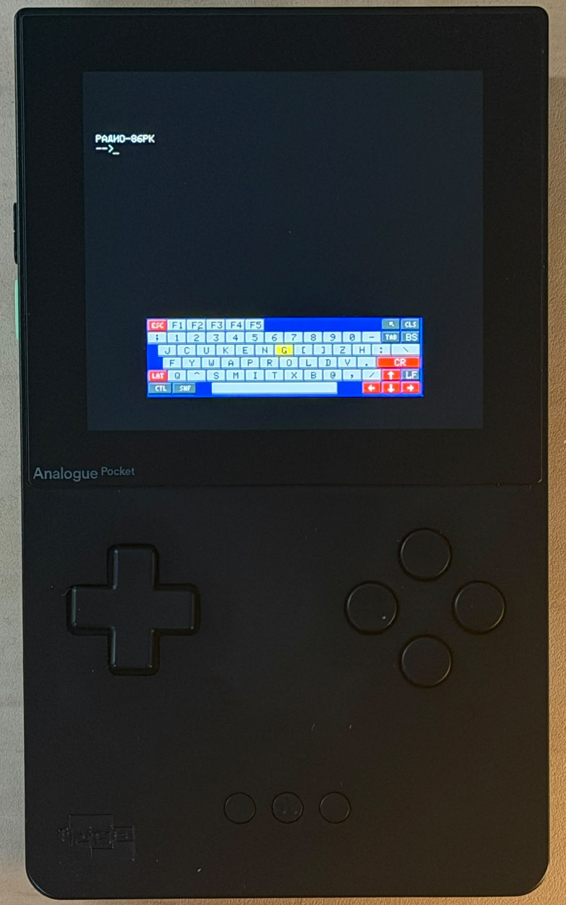
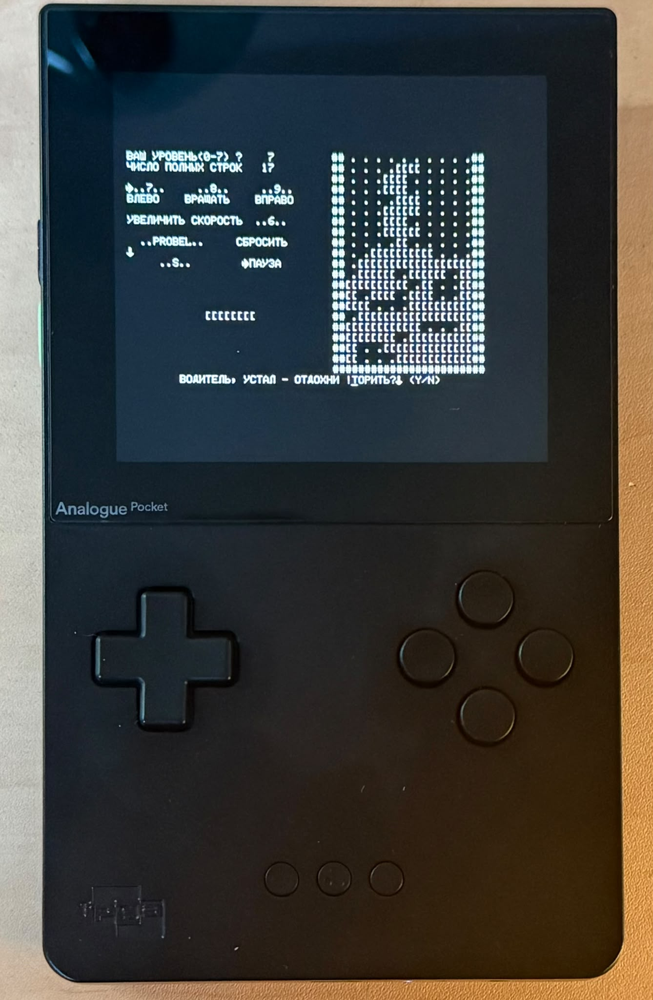
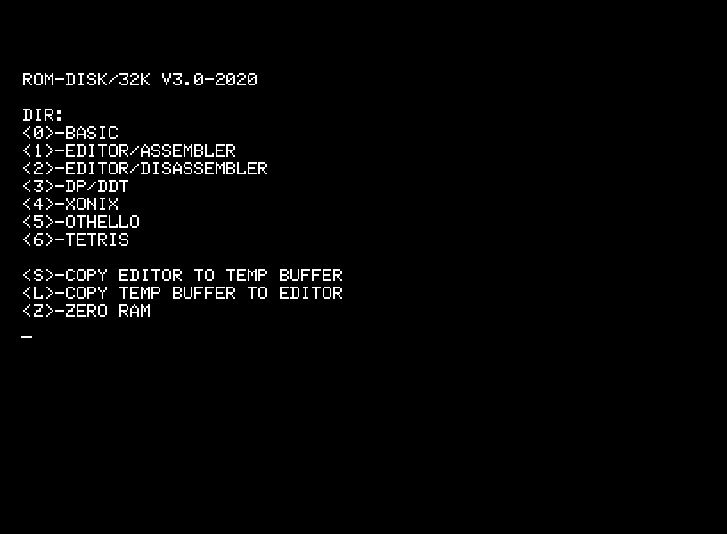
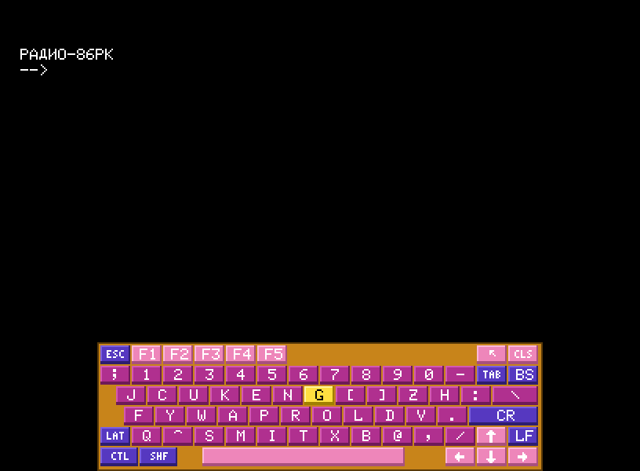
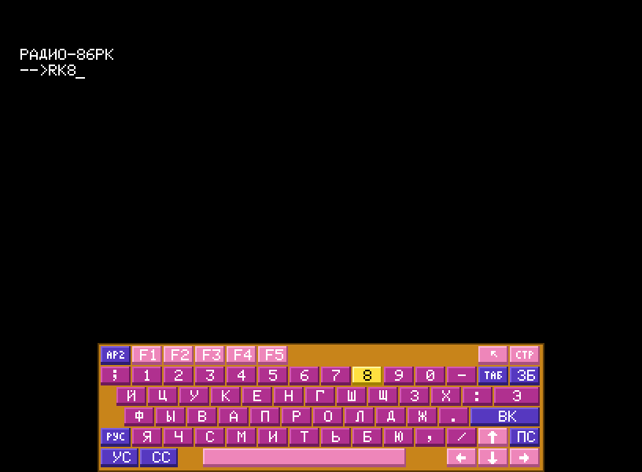

# Radio-86RK for Analogue Pocket

An openFPGA core of the Radio-86RK home computer for the [Analogue Pocket](https://www.analogue.co/pocket).

<p>
  
  
  
</p>

## Status

- Latest release: [0.8.2](https://github.com/BarabashkaD/radio86-rk-pocket/releases/tag/v0.8.2) (2026-11-11), run on a Pocket by the maintainer. Changes: [CHANGELOG.md](CHANGELOG.md).
- Not released yet: ROM disk images up to 8 MB in the Pocket's PSRAM, the J6 bank card, the 32 KB mirror, the J6 card menu (`card.bin`), the FAT16 card (`fatcard.bin`) and the package without ROM disk images (the images as separate downloads).
- An earlier PSRAM test build (10e6cf4, before the J6 card) ran on a Pocket by the maintainer (2026-11-13).
- The test build 0.8.3-j6-test with these changes ran on a Pocket by the maintainer (2026-11-13): `card.bin` and `fatcard.bin` worked.

## Features

- The original's timing: 16 MHz timebase, CPU 1.778 MHz, 8 MHz dots, 50 Hz frames. CPU, DMA, CRT controller and PPI follow their data sheets; the video DMA takes CPU time as on the original ([fpga/README.md](fpga/README.md#the-16-mhz-machine)).
- ROM disk images as separate downloads: Kiselev's ROM disk with a program menu (at its source), 5 game disks (64 KB each) with 48 games, a J6 card menu and a FAT16 card ([ROM disk images](#rom-disk-images)).
- Any ROM disk image up to 8 MB, kept in the Pocket's PSRAM and reloadable from the core's menu. Images above 64 KB are a bank card: a card of whole disks with a card menu, or a FAT16 card of tape files with a file menu. Both are on the release page and can be built from source ([ROM disks and cards](#rom-disks-and-cards)).
- On-screen keyboard (L+R): the 67 real keys, LAT and RUS, Shift and Ctrl, three palettes.
- Button presets for games: cursor keys, digits 7-8-9-6 or 8-4-6-2, WASD, on the D-pad or A B X Y.
- Screen: 408 x 300 at 60 Hz, about 25 picture updates per second. Sound: the beeper (INTE), 48 kHz.
- Core Settings: Reset (keeps memory), Cold boot, Sound, Text colour, Keyboard colours.
- Not supported: savestates, sleep, tape images, the Dock USB keyboard.

## Install

1. Download `BarabashkaD.Radio86RK_<version>_<date>.zip` from the [releases](https://github.com/BarabashkaD/radio86-rk-pocket/releases).
2. Upgrading from 0.5.x: delete `Settings/BarabashkaD.Radio86RK/` on the SD card.
3. Unzip onto the SD card root. The core appears as "Radio-86RK" (category Computer).
4. Optional: download the ROM disk images you want and copy them to `Assets/radio86rk/BarabashkaD.Radio86RK/` ([ROM disk images](#rom-disk-images)).

The package's `Assets/radio86rk/BarabashkaD.Radio86RK/` holds `monitor.bin` and `font.bin` (required) and `ROMDISKS.txt` (the next section as text, with the game lists). Files are loaded as they are, with no checks (monitor up to 2048 bytes, font 1024, ROM disk 8388608).

<!-- romdisk images: python -B scripts/package.py --readme -->
## ROM disk images

The ROM disk is a memory card on the ports of the Radio-86RK's second 8255 (the A000-BFFF block).
The core package holds no ROM disk image: the images are separate downloads, pick the ones you
want. Without an image the core starts as usual, but every ROM disk byte reads FF, so `R0,1FF,0`
and `G0` find no menu: the machine is expected to hang, then use Core Settings > Reset.

### Where to get them

- From the release page of the core version you installed
  (https://github.com/BarabashkaD/radio86-rk-pocket/releases):
  - `romdisk-1.bin` to `romdisk-5.bin`: the five game disks (64 KB each, 48 games).
  - `card.bin`: a J6 bank card with a card menu (458752 bytes): Kiselev's ROM disk and the five
    game disks.
  - `fatcard.bin`: a J6 bank card with a FAT16 file system (8 MB): 52 tape files and a file menu.
  - `romdisk-LICENSE.txt`: Sergey Kiselev's GPL-3.0 licence. `card.bin` holds his ROM disk,
    `fatcard.bin` four programs from it, and the game disks' menu loader is derived from his.
  - `SHA256SUMS.txt`: the SHA256 of every other file attached to the release.
- Sergey Kiselev's ROM disk (ROM-DISK/32K V3.0-2020, GPL-3.0) is not on the release page. Download
  `rom_disk.bin` from his repository and save it as `romdisk.bin`:
  https://raw.githubusercontent.com/skiselev/radio-86rk/c5e9cb7950deacb87d65b59b0dfdf96159d4b98c/Software/rom_disk.bin
  (32256 bytes, SHA256 2e870be7e9820ae34ac62e60479bb5d14c07437a89609cbe0fdfb450ce631904; the file's page:
  https://github.com/skiselev/radio-86rk/blob/c5e9cb7950deacb87d65b59b0dfdf96159d4b98c/Software/rom_disk.bin).

### Where to put them

Copy the images to the folder `Assets/radio86rk/BarabashkaD.Radio86RK/` on the SD card, next to
`monitor.bin` and `font.bin`. The core's menu lists only the `.bin` files of that folder.

### Load an image

- At start the core loads `romdisk.bin` from that folder, if it is there.
- While the core runs: open the Pocket menu (the Analogue button), load the "ROM disk" slot and
  pick a `.bin` file (up to 8 MB). The Pocket holds the machine in reset while it loads the file,
  then the machine restarts as after Core Settings > Reset: the memory is kept, a bank card starts
  on bank 0.
- To start with another image, keep `romdisk.bin` under another name and copy the other image to
  the folder as `romdisk.bin`.
- The image size picks the card: up to 32 KB a 32 KB ROM (8000-FFFF repeat 0000-7FFF), up to 64 KB
  a 64 KB ROM, above 64 KB a J6 bank card (128 banks of 64 KB).

### Start the menu

1. Open the on-screen keyboard with L+R (D-pad selects a key, B presses it, X is CR).
2. At the prompt, type `R0,1FF,0` and CR: the monitor copies the menu loader from the ROM disk to
   address 0000.
3. Type `G0` and CR: the menu appears.
4. Press the key of the program, game or disk. Close the keyboard with L+R to see the whole screen.

- Core Settings > Reset keeps the memory (and the bank of a bank card): `R0,1FF,0` and `G0` show
  the same menu again.
- Core Settings > Cold boot clears the memory and selects bank 0 of a bank card; loading the ROM
  disk slot again selects bank 0 too, with the memory kept.
- A program that loads over the menu loader (Kiselev's DP/DDT and Xonix, as on the real machine):
  Core Settings > Reset, then `R0,1FF,0` and `G0` again.

### Kiselev's ROM disk (romdisk.bin)

- `0` BASIC, `1` EDITOR/ASSEMBLER, `2` EDITOR/DISASSEMBLER, `3` DP/DDT, `4` XONIX, `5` OTHELLO,
  `6` TETRIS.
- `S` copies the editor to the temporary buffer, `L` the temporary buffer to the editor, `Z`
  clears the memory.
- Tetris asks for a level (0-7), then plays with 7 (left), 8 (rotate), 9 (right), 6 (faster) and
  Space (drop); S pauses. Core Settings > Keys = Digits 7-8-9-6 puts them on the D-pad, with Space
  on A.

### The game disks (romdisk-1.bin to romdisk-5.bin)

- The menu lists the games with the keys `0` to `9`, then `A` to `Y`; `Z` clears the memory
  0000-73FF.
- Another game: Core Settings > Reset, then `R0,1FF,0` and `G0` again; `G7416` alone shows the
  menu again too, unless the game has overwritten the loader at 7400-75FF.
- Each game disk is 64 KB: it needs core 0.8.2 or later.

The games of each disk, by menu key: [Game disks](#game-disks).

### The J6 card menu (card.bin)

- The card menu lists `0` KISELEV (Kiselev's ROM disk) and `1` to `5` GAMES 1 to GAMES 5. A key
  starts that disk's own menu, as if it were the only disk.
- Core Settings > Reset keeps the chosen disk: `R0,1FF,0` and `G0` show its menu again.
- Back to the card menu: Core Settings > Cold boot (clears the memory) or load the ROM disk slot
  again; then `R0,1FF,0` and `G0`.

### The FAT16 card (fatcard.bin)

- 52 tape files: the 48 game tapes, and BASIC, EDITOR/ASSEMBLER, EDITOR/DISASSEMBLER and Othello
  from Kiselev's ROM disk. The menu shows 20 files per page, each with its load addresses.
- Close the on-screen keyboard and set Core Settings > Keys = Cursor (another preset sends digits
  or letters, which the menu ignores). Keys on D-pad: Up and Down move the marker, Left and Right
  turn the page, B (CR) or A (Space) runs the file. Keys on A B X Y: X and B move, Y and A turn the
  page, D-pad Down (CR) or Right (Space) runs. `Z` on the on-screen keyboard clears 0000-6BFF.
- A line with `?` instead of addresses is not a tape the loader takes; it does not run.
- Back to the menu: Core Settings > Reset, then `R0,1FF,0` and `G0`. After a Reset during a page
  change or a load: Cold boot or load the ROM disk slot again first.
- CHESS, PACMAN.GAM and Othello load over the menu; `R0,1FF,0` and `G0` load it again.

### Upgrading from 0.8.2

The 0.8.2 package put `romdisk.bin`, `romdisk-1.bin` to `romdisk-5.bin` and `romdisks.txt` in the
folder. Unzipping a newer package deletes nothing: these images stay there and keep working. The
package's `ROMDISKS.txt` replaces `romdisks.txt` (the SD card does not tell upper and lower case
apart, so the file may keep its old name).
<!-- end of romdisk images -->

## ROM disks and cards

The ROM disk is a memory card on the ports of the second 8255 (the A000-BFFF block; the connector J6 on Sergey Kiselev's re-make): port B and port C give the address, port A reads the byte. The image size picks the card:

| Image size | Card | Example |
|---|---|---|
| up to 32 KB | 32 KB ROM; A15 is not wired, so 8000-FFFF repeat 0000-7FFF | `romdisk.bin` (Kiselev's ROM disk) |
| above 32 KB, up to 64 KB | 64 KB ROM, PC7 = A15 | the game disks |
| above 64 KB, up to 8 MB | J6 bank card: 128 banks of 64 KB | `card.bin`, `fatcard.bin` |

- Getting, loading and starting the images: [ROM disk images](#rom-disk-images).
- Without an image every ROM disk byte reads FF. Bytes beyond the end of an image are not cleared: they still hold a longer image's bytes, or whatever an earlier core left in the PSRAM.

### The ROM disk menu

Kiselev's `romdisk.bin` ([where to get it](#where-to-get-them), [its keys](#kiselevs-rom-disk-romdiskbin)) after `R0,1FF,0` and `G0`:



### The bank card

An image above 64 KB is a J6 bank card. Old programs and the monitor's `R` see the selected bank as a plain 64 KB ROM. A program selects another bank with a port C sequence the monitor never makes (PC7 falls while PC0-PC6 stay high; the bank comes from port B).

- Power-up, a load of the ROM disk slot and Core Settings > Cold boot select bank 0. Core Settings > Reset keeps the bank, as a real card has no reset line on J6.
- A program that writes A002/A003 (for example LORUNNER.GAM and SDEMISE.GAM drive port C for sound), or Ctrl-C during a load, can leave another bank selected. Then Cold boot or load the ROM disk slot again.
- The bank cannot be read back.
- Card images are not in the package: `card.bin` and `fatcard.bin` are on the release page ([ROM disk images](#rom-disk-images)), or build them (below).
- A reference design of a real card for J6 (never built): [hardware/j6-bank-card.md](hardware/j6-bank-card.md).

### J6 card menu

A card of whole disks: bank 0 holds the card menu, each further bank one disk with its own menu. The release page has `card.bin`; to build it yourself:

```text
git clone --recursive <repo url>
python -B scripts/fetch_assets.py
python -B scripts/romdisk/build_romdisks.py
python -B scripts/romdisk/card.py
```

`card.py` writes `build/card/card.bin` (458752 bytes) and `card.json`: key `0` is `romdisk.bin` (KISELEV), keys `1`-`5` the game disks 1-5. Other disks: `python -B scripts/romdisk/card.py [--out DIR] [--title T] [--name NAME ...] DISK ...` (up to 19 disks, fewer with long names; names up to 16 characters; a disk of up to 64 KB each).

Copy `card.bin` to `Assets/radio86rk/BarabashkaD.Radio86RK/` and load it in the ROM disk slot from the core's menu (or copy it as `romdisk.bin`). Its menu: [The J6 card menu (card.bin)](#the-j6-card-menu-cardbin).

### FAT16 card

An 8 MB card image that is a FAT16 file system: 52 tape files (the 48 game tapes, and BASIC, EDITOR/ASSEMBLER, EDITOR/DISASSEMBLER and Othello from Kiselev's ROM disk). Bank 0 holds a boot stage, a file menu and a loader. The release page has `fatcard.bin`; to build it yourself:

The builder needs mtools: on Windows the MSYS2 UCRT64 package `mingw-w64-ucrt-x86_64-mtools`, on Linux `apt install mtools`; set `MTOOLS_DIR` to their directory, or put them on PATH.

```text
git clone --recursive <repo url>
python -B scripts/fetch_assets.py
python -B scripts/fatcard/fatcard.py
```

`fatcard.py` writes `build/fatcard/fatcard.bin` (8388608 bytes) and `fatcard.json` (the file list).

Copy `fatcard.bin` to `Assets/radio86rk/BarabashkaD.Radio86RK/` and load it in the ROM disk slot from the core's menu. Its menu and keys: [The FAT16 card (fatcard.bin)](#the-fat16-card-fatcardbin).

- In the menu X (BS) on the D-pad preset, or D-pad Up (BS) on the A B X Y preset, does nothing. `R0,1FF,0`, `G0` brings the menu back also while it waits for a key; there is no shortcut like `G7416`.
- A tape the loader takes: optional E6, start, end (high byte first), the bytes; it must load into 0000-73FF and be below 64 KB. The checksum is not checked. The loader checks the file, and the FAT chain of every cluster the load needs, before it writes memory; a refusal (`NOT A TAPE`, `BAD FILE`) returns to the monitor's prompt.
- The menu shows the root directory in its order: 8.3 names, up to 511 files; files added with mtools appear too.
- FAT16 only: a FAT12 volume (fewer than 4085 clusters, about 2 MB or less) is not detected by the boot stage and loads wrong data; build images with `fatcard.py`.
- CHESS, PACMAN.GAM and Othello load over the menu (6C00-73FF).
- BASIC: the file runs to 2117h with zeros, so RAM 2000-2117 is cleared (Kiselev's loader cleared only 2117h).
- DP/DDT is not on the card yet: it loads to 6400-76FF, over the loader and the monitor's variables.

## Game disks

`romdisk-1.bin` to `romdisk-5.bin` (64 KB each; core 0.8.2 or later, an older core refuses them): the 48 game tapes of the Karabas core, each disk with a menu loader derived from Sergey Kiselev's (`scripts/romdisk/rom_loader_games.asm`, GPL-3.0). They are on the release page ([ROM disk images](#rom-disk-images)), not in the package; `python -B scripts/romdisk/build_romdisks.py` builds them into `build/romdisks`. The package's `ROMDISKS.txt` and the core's info list the games too.

<!-- game disks: python -B scripts/romdisk/build_romdisks.py --readme -->
**`romdisk-1.bin`** (9 games)

| Key | Game | Title |
|---|---|---|
| 0 | CHERV | Червяк |
| 1 | CHESS | Шахматы |
| 2 | KROK | Крок |
| 3 | SKACHKI | Еще одни скачки |
| 4 | SKVOTCH | Сквош |
| 5 | SOS1 | SOS - 1 вариант |
| 6 | SOS2 | SOS - 2 вариант |
| 7 | TENNIS | Еще один теннис |
| 8 | UDAW | Удав |

**`romdisk-2.bin`** (10 games)

| Key | Game | Title |
|---|---|---|
| 0 | KRESTNO.GAM | Крестики-нолики |
| 1 | KRESTNO.RKR | Крестики-нолики |
| 2 | MAZE | Maze |
| 3 | PACMAN1 | Еще один пакман |
| 4 | PAKET2 | Пакет из 4 игр |
| 5 | PITON | Питон |
| 6 | TETRIS1 | Тетрис - 1 вариант |
| 7 | UTKA | Утка |
| 8 | VOLCANO | Вулкан |
| 9 | XONIX1 | Ксоникс-микрон |

**`romdisk-3.bin`** (10 games)

| Key | Game | Title |
|---|---|---|
| 0 | DIVERSE | Диверсант |
| 1 | LABYRINT | Лабиринт |
| 2 | LEST | Лестница |
| 3 | PACMAN | Еще один pacman |
| 4 | PINGPONG | Еще один пинг-понг |
| 5 | PVO | ПВО-87 |
| 6 | SLAMS | Slams |
| 7 | SPITON | Super Piton (говорящий !) |
| 8 | STRANGER | Strangers |
| 9 | TOCHKI | "Жизнь" с разнотипными точками |

**`romdisk-4.bin`** (9 games)

| Key | Game | Title |
|---|---|---|
| 0 | BOMBER | Бомбардировщик |
| 1 | CIRCUS | Цирк |
| 2 | GFIRE | Cross Fire |
| 3 | GLASS1 | Стакан - 1 вариант |
| 4 | GLASS2 | Стакан - 2 вариант |
| 5 | PAKET | Пакет из 6 игр |
| 6 | XONIX | Ксоникс |
| 7 | XONIXZM | Пакет из 2 игр (xonix, змея) |
| 8 | ZMEI | Змей-горыныч |

**`romdisk-5.bin`** (10 games)

| Key | Game | Title |
|---|---|---|
| 0 | LESTN1 | Лестница-1 |
| 1 | LORUNNER | Lode Runner |
| 2 | PACMAN | Еще один пакман (колобок) |
| 3 | PUSHER | Pusher |
| 4 | RIKOSHET | Рикошет |
| 5 | SDEMISE | Spy's demise |
| 6 | TAPPER | Barmen |
| 7 | TETR2 | Еще один тетрис |
| 8 | TETRIS4 | Тетрис - 4 вариант |
| 9 | ZAGIB | Загибон |
<!-- end of game disks -->

- Load a disk from the core's menu, or copy it as `romdisk.bin`; its menu keys: [The game disks](#the-game-disks-romdisk-1bin-to-romdisk-5bin). The [J6 card menu](#j6-card-menu) puts all five on one card.
- Each game starts at its load address; a game that needs another start address does not start.

## On-screen keyboard

L+R opens it at the bottom of the screen. Each key shows what it types now: LAT or RUS (R switches), shifted symbols with Shift latched, control names with Ctrl (L) held.



RUS key names: ВК (CR), ЗБ (BS), АР2 (ESC), СТР (CLS), ПС (LF), УС (CTL), СС (SHF).



## Controls

- Keyboard open: D-pad selects; B presses (held while held); A Space, Y BS, X CR, Start ESC; Select + D-pad the arrows.
- L tap latches Shift (next tap releases); L held is Ctrl; R is RUS/LAT. Open or closed.
- With the keyboard open the prompt stays on the bottom row; CLS brings it to the top.
- Keyboard closed: Core Settings > Keys (Cursor, Digits 7-8-9-6, Digits 8-4-6-2, WASD), Keys on (D-pad or A B X Y), Escape (Select, Start or None).
- Keys on D-pad: A Space, B CR, X BS, Y Y. Keys on A B X Y: X Up, B Down, Y Left, A Right; D-pad Right Space, Down CR, Up BS, Left Y.
- Escape: the chosen button sends ESC, the other CR; None: both CR.

## Building from source

```text
git clone --recursive https://github.com/BarabashkaD/radio86-rk-pocket
cd radio86-rk-pocket
python -B scripts/fetch_assets.py
pwsh -File scripts/build.ps1
python -B scripts/package.py --version <version> --date <YYYY-MM-DD>
```

- Prerequisites (versions, sources, environment variables: [AGENTS.md, section 3](AGENTS.md#3-prerequisites)): Quartus Prime Lite 25.1std with Cyclone V device support (no licence file needed; the bitstream only); Icarus Verilog 13.0 (the simulations and the Python tests); Python 3.14 (standard library only); PowerShell 7; git; mtools (the FAT16 card and its tests). Tools on PATH need no environment variables.
- The bitstream builds on Windows only; the simulations, the Python tests and the package dry run (`pwsh -File scripts/ci/package-dry-run.ps1`) also on Linux, as in CI.
- A GitHub source zip has no submodule (`cores/karabas-go-core-rk86`): clone with `--recursive`. `fetch_assets.py` needs the network once (GitHub).
- The package holds no ROM disk image. The game disks (`python -B scripts/romdisk/build_romdisks.py`) and the card images ([J6 card menu](#j6-card-menu), [FAT16 card](#fat16-card)) are built separately; the FAT16 card and its tests need mtools (`MTOOLS_DIR` or PATH).

Design, build and tests: [fpga/README.md](fpga/README.md). Instructions for coding agents: [AGENTS.md](AGENTS.md).

## Credits

- **Dmitry Tselikov**: the FPGA Radio-86RK replica (2010-2011; [his FPGA page](http://bashkiria-2m.narod.ru/index/fpga/0-12)); his DMA and CRT models are the base of this core's 8257 and 8275.
- **[Karabas Go core](https://github.com/andykarpov/karabas-go-core-rk86)** by Andy Karpov, with ports by Dmitriy Schapotschkin and Oleh Chastukhin: the monitor, font and game tapes. The machine `rk86_machine16` is in the fork [BarabashkaD/karabas-go-core-rk86](https://github.com/BarabashkaD/karabas-go-core-rk86), branch `rk86-16mhz`, `src/rtl/rk86_16/`.
- **Vslav** (1801BM1): the 8080 model, CC-BY 3.0 (<https://creativecommons.org/licenses/by/3.0/>), from the [Apogee core](https://github.com/MiSTer-devel/Apogee_MiSTer) at `4b37da2`.
- **Sorgelig**: the [Apogee core](https://github.com/MiSTer-devel/Apogee_MiSTer) for MiSTer, source of the 8080, 8257 and 8275 models.
- **Sergey Kiselev**: the [Radio-86RK re-make](https://github.com/skiselev/radio-86rk): the ROM disk, the keyboard design and colours, the schematics this core follows with the original's (Радио 1986 No. 4-5).

Licences: [LICENSES.md](LICENSES.md).
