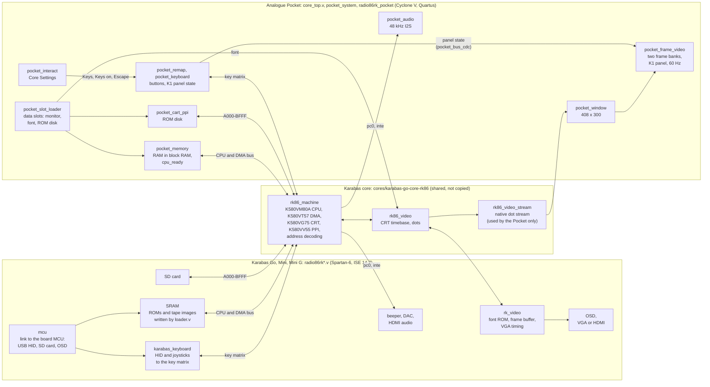

# fpga/: the Pocket implementation

The FPGA side of the Radio-86RK core for the Analogue Pocket (Cyclone V 5CEBA4F23C8, Quartus Prime Lite 25.1std). It is self-contained: the SD package in `../package/` only needs the bitstream that this directory builds.

The Radio-86RK machine is the Karabas core (`rk86_machine`, `rk86_video`, `rk86_video_stream`). `fpga/` reads it only through `RK86_CORE_DIR`, the core's `src` directory; the default is `../../cores/karabas-go-core-rk86/src`, the submodule. The core sources are never copied or patched. Moving `fpga/` elsewhere means changing `RK86_CORE_DIR`.

## Architecture

The Karabas boards and the Pocket run the same Radio-86RK code: the board-neutral modules of the Karabas core (the CPU, DMA, CRT controller, PPI, the address decoding and the native video). Each platform puts its own board around them: the clock, the memory and the ROMs, the keyboard, the device in the window A000-BFFF, the display and the sound. How a platform connects the modules is in the core's [docs/integration.md](https://github.com/BarabashkaD/karabas-go-core-rk86/blob/c7d7a9288f1fb14e515572e972af3dec34cc5b53/docs/integration.md); its [README](https://github.com/BarabashkaD/karabas-go-core-rk86/blob/c7d7a9288f1fb14e515572e972af3dec34cc5b53/README.md#architecture) has the Karabas side in more detail (both at the commit the submodule pins).



Side by side:

| Part | Karabas boards | Analogue Pocket |
|---|---|---|
| Top | `src/radio86rk.v`, `radio86rk_mini.v`, `radio86rk_minig.v`; XC6SLX25, ISE 14.7 | `core/core_top.v` (APF template: pins, bridge, PLL) with one `pocket_system` (assets, settings, video, audio) around `radio86rk_pocket` (the board); 5CEBA4F23C8, Quartus 25.1std |
| Machine | `rk86_machine`, `rk86_video` (inside `rk_video`) | the same modules, from the submodule, plus `rk86_video_stream` |
| Clock | 40 MHz from a PLL (the signal is historically named `clk50`), `ce` = 1 | `clk_74a` (74.25 MHz) with `ce` on 160 of 297 ticks: 40 MHz on average (below) |
| Memory | external SRAM, `cpu_ready` = 1 | `pocket_memory`: RAM 0000-7FFF and the monitor (8000-87FF of the array) in one byte-wide block RAM with one port (the CPU, the DMA while it holds the bus, the loader in reset); `cpu_ready` waits 1 clk for a read and for the ROM disk; the RAM cleared at the first boot and by Cold boot |
| Monitor and font | `BIOSSD.BIN` or `BIOS.BIN` (OSD switch "ROM"), written into the SRAM from the core file by the MCU; the font in a Coregen ROM | `BIOS.BIN` (the stock monitor) into `pocket_memory` and `FONT.BIN` into its own byte-wide memory (`pocket_rom8`), written byte by byte from the data slots (`pocket_slot_loader`), no checks |
| Window A000-BFFF | the SD card, used by `BIOSSD.BIN` | the ROM disk behind an 8255 (`pocket_cart_ppi`), as on the real machine |
| Programs | tape images (`.rkr`, `.rk`, `.gam`) from the SD card through the OSD, written into the memory by `loader.v`; Autorun types the start keys (`macros.v`) | from the ROM disk menu (`R0,1FF,0`, `G0`); slot 3 is reserved for tape images |
| Keyboard | a USB keyboard and joysticks through the MCU (`hid_parser`, `karabas_keyboard`) | the Pocket buttons (`pocket_remap`, `pocket_keyboard`) and the K1 on-screen keyboard; the Dock USB keyboard is reserved |
| Video | `rk_video`: frame buffer and VGA timing; VGA (Go) or HDMI (Mini, Mini G) | `rk86_video_stream` into `pocket_window` (408 x 300, the same window as the Karabas frame buffer), two frame banks in `pocket_frame_video` to the 60 Hz Pocket screen, the K1 panel drawn over it |
| Sound | `pc0` and `inte` mixed per board: beeper pin, DAC, HDMI audio | `pc0 ^ inte` (the Karabas beeper) to 48 kHz I2S (`pocket_audio`) |
| Settings | OSD (MCU soft switches) | Core Settings (`package/core/interact.json`, `pocket_interact`) |

## Directories

| Path | Content |
|---|---|
| `apf/`, `core/` | the APF template (open-fpga/core-template da3a021) with the Analogue notices; `core/core_top.v` holds the pins, the bridge, the PLL and one instance of `pocket_system` |
| `rtl/` | our logic; `pocket_system.v` is everything behind the template, `radio86rk_pocket.v` is the board around the machine |
| `quartus/` | `ap_core.qsf`, `create_project.tcl`, the CDC and timing report scripts |
| `sim/` | `run_sim.py` and `frame_compare.py`; `unit/` module TBs, `system/` the TB of `pocket_system`, `memory/` the Pocket memory for the core's machine TB, `negative/` faults as `.patch`, `golden/` the reference frames of the earlier proof-of-concept core |

## How the clocks work

```text
Pocket (APF) clk_74a = 74.25 MHz
 |
 +--> clock enable: 160 of every 297 ticks ----> 40 MHz timebase (on average exactly 40.000 MHz)
 |     the Radio-86RK machine, the memory, the        |
 |     keyboard, the ROM disk, the bridge             +--> CPU: one step every 28  = 40 / 28 = about 1.43 MHz
 |                                                    +--> screen: one dot every 3 = 13.33 MHz
 |                                                    +--> a frame every 959 760   = 41.7 frames per second
 |                                                                  |
 |                                                              frame buffer (two banks)
 |                                                                  |
 +--> PLL ---> clk_core_12288 = 12.288 MHz ------------> Pocket screen: 60 Hz, 408 x 300 shown
                                         ------------> sound: 48 kHz I2S (the beeper)
```

- **The machine runs on `clk_74a`,** the 74.25 MHz clock the Pocket gives every core, not on a PLL clock. It advances only when a clock enable is high: on 160 of every 297 ticks. On average that is exactly 74.25 × 160 / 297 = **40 MHz**, the master timebase of the Karabas core; on the Karabas boards it is a real 40 MHz clock with the enable always on.
  - Programs run at exactly the Karabas core's speed, with no drift.
  - Single steps are 13.5 or 26.9 ns apart instead of an even 25 ns. Nothing outside sees that jitter: the picture is re-timed by the frame buffer, and the sound is sampled at 48 kHz.
- **From the 40 MHz timebase** the core derives the CPU, the screen dots and the frames (the Karabas core's [docs/integration.md](https://github.com/BarabashkaD/karabas-go-core-rk86/blob/c7d7a9288f1fb14e515572e972af3dec34cc5b53/docs/integration.md), section 2). The CPU takes a step every 28 timebase steps: **40 / 28 ≈ 1.43 MHz**.
  - The original Radio-86RK's CPU ran at about **1.78 MHz**, so the replica's CPU is about 20% slower. Why, how to reach the original speed, and a configurable speed with turbo modes are planned follow-up tasks.
- **The PLL is used only for the Pocket's screen and sound.** It makes 12.288 MHz, which APF requires for the 60 Hz video output and the 48 kHz audio. A frame buffer with two banks sits between the machine's 41.7 Hz frames and the 60 Hz screen.
- **If the PLL loses lock** (rare: a power transient, ESD), only the picture and sound stop. The machine, its memory and the running program go on. A watchdog restarts the PLL if it does not lock again by itself within 28 ms, and the picture comes back with the program still running.

## Bridge map

Registers decode all 32 address bits. Status (`rtl/pocket_system.v`) and the interact registers (`rtl/pocket_interact.v`) answer `0x0000_0000-0x0000_01FF`; the mux in `core/core_top.v` sends `0xF8xx_xxxx` to the APF command block. Any other address in the window reads 0.

| Address | Use |
|---|---|
| 0x0000_0000 | Identity, `0x524B4D31` |
| 0x0000_0008 | Flags: bit 0 boot done (PLL lock), 1 setup done, 2 `reset_n`, 3 assets valid, 4 memory ready |
| 0x0000_0014, 0x1C, 0x20, 0x3C | Read 0 (the asset status and the CRC32 values until 0.6.3) |
| 0x0000_0024 | CPU address (low 16 bits) |
| 0x0000_0028 | Count of native frames |
| 0x0000_0034 | Keyboard panel: bit 7 panel open, bits 6:0 selected key id (0..66) |
| 0x0000_0044 | Keyboard state: bit 0 RUS (`rus_mode`), 1 SS (Shift) line, 2 US (Ctrl) line, 3 RUS line, 4 Shift latch, 5 Dock keyboard |
| 0x0000_0030, 0x38, 0x40 | Read 0 (the proof of concept's D/Enter injection, game keys and cartridge guard are removed) |
| 0x0000_0100 | Action (write): 1 Reset, 2 Cold boot; one clock pulse; reads 0 |
| 0x0000_0104 | Sound, bit 0, default 1 |
| 0x0000_0108 | Text colour, bit 0: 0 white, 1 green |
| 0x0000_010C | Keys: 0 Cursor, 1 Digits 7-8-9-6, 2 Digits 8-4-6-2, 3 WASD (writes above 3 are ignored) |
| 0x0000_0110 | Keys on: 0 D-pad, 1 A B X Y (writes above 1 are ignored) |
| 0x0000_0114 | Escape: 0 Select, 1 Start, 2 None (writes above 2 are ignored) |
| 0x0000_0118 | Keyboard colours: 0 Pink (v1.1), 1 Grey (v1.4), 2 Mono (writes above 2 are ignored) |
| 0x0000_011C-0x0000_0144 | Reserved; read 0, writes ignored |
| 0x2000_0000, 0x2100_0000, 0x2200_0000 | Data slots 0, 1, 2 (below) |
| 0x2300_0000 | Reserved: slot 3, tape image |
| 0xF8xx_xxxx | APF |

The interact registers have no reset. Pocket OS writes the saved values while `reset_n` is low and reads them back every frame; the initial values are the defaults of `package/core/interact.json`.

## On-screen keyboard (K1)

- `rtl/pocket_keyboard.v`: the buttons as keyboard lines. The 64 matrix keys, and SS (Shift), US (Ctrl) and RUS/LAT as separate lines (ids 64..66), are pulled low and ANDed with the mapped keys. It also holds the panel state: open, selection, the Shift latch. Timings (tap, chord window, RUS minimum, minimum hold, auto-repeat) are parameters in milliseconds.
- `rtl/pocket_k1_panel.v`: draws the 284 x 82 panel in the 12.288 MHz output stage (`pocket_frame_video.v`), 3 clocks of latency; the picture path is delayed to match. It reads the state once per frame (at x = 0, y = 0).
- `rtl/pocket_k1_layout.vh`: generated key table, labels, small glyphs and palettes. Do not edit it. The single source is `scripts/k1/layout.py`; regenerate with `python -B scripts/k1/gen_verilog.py` (a test checks the file is up to date). The labels come from the monitor's key decoder, run on `BIOS.BIN` by `scripts/k1/monitor_decoder.py`.
- `rtl/pocket_bus_cdc.v` (+ `.sdc`): a toggle handshake that carries the state word from `clk_74a` to the video clock whole. The constraint cuts the held-word path and the two token paths; the synchronizer stages stay timed.
- Test model, not RTL (nothing includes it): `rtl/pocket_key_defs.vh`: `native_character`, the model of the monitor's decoder (FF06), checked against all 512 key and modifier cases.

The state bus (78 bits, `clk_74a` to the video clock):

| Bits | Meaning |
|---|---|
| 0 | panel open |
| 7:1 | selected key id |
| 8 | RUS (`rus_mode`) |
| 9, 10, 11 | SS (Shift), US (Ctrl), RUS lines pulled |
| 75:12 | matrix line k pulled, at bit 12+k |
| 77:76 | palette: 0 Pink, 1 Grey, 2 Mono |

## Data slots

From `package/core/data.json`. The sizes are exact.

| Id | Name | File | Address | Size (bytes) | Required |
|---|---|---|---|---|---|
| 0 | Monitor | monitor.bin | 0x2000_0000 | up to 2048 | yes |
| 1 | Font | font.bin | 0x2100_0000 | up to 1024 | yes |
| 2 | ROM disk | romdisk.bin | 0x2200_0000 | up to 32768 | no |

The files are written as they are, byte by byte (`pocket_slot_loader`); bytes beyond the size APF asked for, and every slot write while the core runs, are dropped. A missing ROM disk is legal: its memory starts at FF, so A000-BFFF reads FF, as do the bytes after a shorter image. A wrong monitor or font runs as it is (no CRC, no red frame). The sizes and CRCs of the bundled files, checked when they are fetched and packaged, are in [../package/assets.json](../package/assets.json).

## Core Settings size limit

On Pocket OS 2.7 the first version of the core did not start: the Pocket stopped right after opening `interact.json` (its log shows the file being opened, then the error; a working core goes on to `video.json`). Variants of the file, tried on the hardware:

| File | Items | List options in total | Result |
|---|---|---|---|
| empty | 0 | 0 | loads |
| 5 basic items | 5 | 7 | loads |
| 5 basic + 2 Map lists of 16 | 7 | 39 | loads |
| 15 items, Map lists cut to 2 options | 15 | 27 | loads |
| a working core (Vector06C) | 12 | 66 | loads |
| 15 items, Map lists of 9 options | 15 | 97 | fails |
| the first shipped file | 15 | 167 | fails |

The documented limits (16 items, 16 options per list, 23-character names) were all met, so the Pocket has an undocumented limit on the total size of the lists, somewhere between 66 and 97 options. The Core Settings of this core are therefore kept small (8 items, 14 list options in total); `scripts/package.py` refuses more than 20.

## Build and tests

Prerequisites: Quartus Prime Lite 25.1std (`QUARTUS_ROOT`, or `quartus_sh` on PATH), Icarus Verilog 13 (`IVERILOG` or `--iverilog`), Python 3, PowerShell 7. The ROM disk is fetched into `build/assets` by `scripts/fetch_assets.py`.

```text
pwsh -File scripts/build.ps1                       build in build/quartus, then scripts/check_build.py
python -B fpga/sim/run_sim.py                      every test that is not slow
python -B fpga/sim/run_sim.py --slow               adds the system scenarios
python -B fpga/sim/run_sim.py --negative           each fault must fail with its named error
python -B fpga/sim/run_sim.py boot menu            named tests only
```

Tests of the keyboard:

- `keyboard`: the buttons, the chord, L and R, navigation and auto-repeat, with five faults.
- `k1_panel`: the panel in the output stage, 7 states, every pixel compared with the Python model (`scripts/k1/layout.py`).
- `bus_cdc`: the handshake with random gaps and a destination reset.
- `k1` (slow, about 40 minutes): the system scenario. It opens the panel, types through it, and captures 7 frames (Shift latch, RUS, Ctrl, three palettes). `python -B scripts/k1/check_frames.py build/sim/k1` compares each panel with the model.
- `python -B -m unittest scripts/tests/test_k1_layout.py` (needs `IVERILOG`): the key table, the generated file, `native_character` against the monitor's decoder (512 cases) and every `k1_*` function against the model.

The core's machine TB runs on the Pocket memory (`pocket_memory.v`) in place of the core's own model (`--iverilog` is needed when `iverilog` is not on PATH):

```text
python -B cores/karabas-go-core-rk86/src/sim/machine/run_machine_sim.py [--iverilog PATH] --mem fpga/sim/memory/tb_rk86_mem.v fpga/rtl/pocket_memory.v
```

`scripts/check_build.py` checks every Quartus build (no errors, timing met). Simulation and build results are not hardware verification.

## Licences

`apf/` and `core/` carry the Analogue notices (see `apf/TEMPLATE-NOTICES.md`). The rest of `fpga/` is BSD-3-Clause. All parts: [../LICENSES.md](../LICENSES.md).
