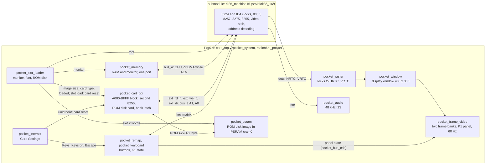

# fpga/: the Pocket implementation

The FPGA side of the Radio-86RK core for the Analogue Pocket (Cyclone V 5CEBA4F23C8, Quartus Prime Lite 25.1std). It is self-contained: the SD package in `../package/` only needs the bitstream that this directory builds.

The Radio-86RK machine is `rk86_machine16` of the Karabas core fork (`src/rtl/rk86_16/`): the original's 16 MHz machine at bus-cycle level, every chip to its data sheet. `fpga/` reads it only through `RK86_CORE_DIR`, the core's `src` directory, and its source list `rk86_machine16.prj`; the default is `../../cores/karabas-go-core-rk86/src`, the submodule. The core sources are never copied or patched. Moving `fpga/` elsewhere means changing `RK86_CORE_DIR`.

## Architecture

The Karabas boards and the Pocket run the same Radio-86RK code: the board-neutral modules of the Karabas core (the CPU, DMA, CRT controller, PPI, the address decoding and the native video). Each platform puts its own board around them: the clock, the memory and the ROMs, the keyboard, the device in the A000-BFFF block, the display and the sound. How a platform connects the modules is in the core's [docs/integration.md](https://github.com/BarabashkaD/karabas-go-core-rk86/blob/d995355b9a27aa20f4495a617186b3f088e77d34/docs/integration.md); its [README](https://github.com/BarabashkaD/karabas-go-core-rk86/blob/d995355b9a27aa20f4495a617186b3f088e77d34/README.md#architecture) has the Karabas side in more detail (both at the commit the submodule pins).

The Pocket runs `rk86_machine16`; the Karabas boards keep `rk86_machine`. From the submodule the Pocket uses only `src/rtl/rk86_16/`, `src/rk86_machine16.prj`, `src/sim/machine16/`, `src/sim/negative.py`, `src/roms/BIOS.BIN`, `src/roms/FONT.BIN` and `pk/`. Planned: the chip models and the machine move into their own repositories.



## Directories

| Path | Content |
|---|---|
| `apf/`, `core/` | APF template (open-fpga/core-template da3a021) with the Analogue notices; `core/core_top.v`: pins, bridge, PLL, one `pocket_system` |
| `rtl/` | our logic; `pocket_system.v` is everything behind the template, `radio86rk_pocket.v` the board around the machine |
| `quartus/` | `ap_core.qsf`, `create_project.tcl`, CDC and timing report scripts |
| `sim/` | `run_sim.py`, `frame_compare.py`, `run_core_machine.py`; `unit/`, `system/`, `memory/` (`tb_rk86_mem16.v`, `psram_model.v`), `cpu16/`, `negative/` (faults as `.patch`), `golden/` (reference frames) |

## Clocks

```text
clk_74a = 74.25 MHz
 |
 +--> ce16: 64 of every 297 ticks = 16 MHz on average (the original's crystal): machine, memory, keyboard, ROM disk, bridge
 |     +--> 8224: Φ1 / Φ2 every 9 = 1.778 MHz: CPU; the 8257 on both Φ2 edges
 |     +--> К155ИЕ4: every 2 = 8 MHz dots; every 12 = 1.333 MHz 8275 character clock
 |     +--> 8275: 516 dots x 310 lines = 50.01 Hz, single scan (from the monitor's init bytes)
 |              |
 |          pocket_raster, pocket_window (display window), frame buffer (two banks)
 |              |
 +--> PLL: 12.288 MHz --> Pocket screen 60 Hz, 408 x 300; sound 48 kHz I2S
```

- The 16 MHz periods are 53.9 or 67.3 ns (jitter); the frame buffer and the 48 kHz sampling hide it.
- The dividers run freely, as on the board. Reset is held 144 `ce16`. The 8275 has no reset pin; it runs until the monitor's Reset command.
- The PLL drives only screen and sound. On lock loss only they stop; a watchdog restarts the PLL after 28 ms.
- The PSRAM controller runs on `clk_74a` too (no other clock).

## The 16 MHz machine

Origin, licence and changes of each file: the fork's [src/rtl/rk86_16/README.md](https://github.com/BarabashkaD/karabas-go-core-rk86/blob/d995355b9a27aa20f4495a617186b3f088e77d34/src/rtl/rk86_16/README.md) and the file headers. Sources of behaviour: the data sheets, then the boards (Радио 1986, Kiselev 1.4). Where the data sheets are silent, the decisions and planned real-hardware checks are in that README.

| Chip | File | Model |
|---|---|---|
| 8080 (КР580ВМ80А) | `k580vm80a.v` | Vslav's model, unchanged but for line endings; READY high, INT low |
| 8224, К155ИЕ4 | `rk86_clocks16.v` | Φ1 / Φ2, RESET and READY flip-flops, STSTB; dot and character clocks |
| 8257 (КР580ВТ57) | `k580vt57.v` | to the Intel data sheet, from Tselikov's model with Sorgelig's changes |
| 8275 (КР580ВГ75) | `k580vg75.v` | to the Intel data sheet, from the same base; HRTC and VRTC are its outputs |
| 8255 (КР580ВВ55А) | `k580vv55.v` | to the data sheet: modes 0, 1, 2; the keyboard 8255 and the second 8255 (A000-BFFF block) |
| video path | `rk86_video16.v` | font ROM on CC and LC, К155ИР13 shift register, К155ТМ2, RVV as on Kiselev 1.4 |
| board | `rk86_machine16.v` | the Радио 1986 glue: address decoder, ЧТЕНИЕ = DBIN XOR MEMW, memory written by CPU WR only, start-up mapping |

- **Address map** (the Радио 1986 board's design, reproduced): the decoder looks only at A15-A13 and selects one device per 8 KB block: RAM 0000-7FFF, keyboard 8255 8000-9FFF, the A000-BFFF block (second 8255), the 8275 C000-DFFF, E000-FFFF the 8257 (writes) and the monitor ROM (reads). An 8255 has 4 registers (port A, port B, port C, control), picked by its address pins A1, A0, which take address lines A1, A0; it decodes nothing else, so its registers repeat every 4 bytes of its block (A000-A003 is the copy the monitor and the ROM disk loaders use). A port is 8 pins of the chip.
- **The A000-BFFF block**: on the board the second 8255 (D14), the interface PPI whose ports go to the external connector; a ROM disk is one peripheral on it. The machine's ports for it are `ext_rd_n`, `ext_we_n`, `ext_di` (the "window" of the fork's sources). On the Pocket: `pocket_cart_ppi` (next section).
- **DMA** (the board's wiring): the 8257 uses only channel 2, memory to the 8275; its MEMR is not connected. While AEN is high the address bus carries the 8257's address, and the 8275 receives the byte of whatever is there (RAM, an 8255, the 8275, the monitor ROM): DMA reads are decoded like CPU reads. Bursts of 8 characters; the 8275 drops DRQ at every DMA write, so the 8257 makes one HOLD period per character. The CPU keeps about 45 % of the Φ cycles; programs run slower than in emulators that model continuous bursts.
- **Memory**: one port at `bus_a` (CPU, or 8257 while AEN); the byte follows `bus_a` one `clk` later whatever the read strobe; written only by the CPU's WR, never during AEN or while the monitor is selected; no wait states.
- **Start-up mapping**: from reset to the first read with A15 = 1 the monitor answers every address; RAM and devices are off.
- **Sound**: INTE only, as on both boards.

## ROM disk cards (the A000-BFFF block)

`rtl/pocket_cart_ppi.v`: the fork's 8255 with a ROM disk card on its ports (on Kiselev 1.4 the connector J6). Port B is ROM A0-A7, port C A8-A15, port A the ROM byte, always (no output enable). Pins programmed as inputs float high (FF). With no image in slot 2 (`loaded` low) port A reads FF. The 8255's A1, A0 come from the system address `bus_a`, also during DMA. The ROM address A22-A0 goes to `pocket_psram`, whose byte comes back as `rom_data` (at most 24 clk after an address change; the 8080 reads port A at least 167 clk after a port write).

The card is chosen by the image size (`pocket_slot_loader` flags `romdisk_64k`, `romdisk_card`): Pocket emulation by size, not limits of the bank card (on a real board: which card is plugged in).

| Image size | Card | ROM address A22-A0 |
|---|---|---|
| up to 32768 bytes | 32 KB ROM, A15 not wired | `{0, PC6..PC0, PB}`: 8000-FFFF mirror 0000-7FFF (the maintainer's decision) |
| 32769 to 65536 bytes | 64 KB ROM | `{0, PC7..PC0, PB}` (PC7 = A15); no bank latch |
| 65537 to 8388608 bytes | J6 bank card, 128 banks of 64 KB | `{bank[6:0], PC7..PC0, PB}` |

- **Bank select**: one event, PC7 falls and, after the fall, PC0-PC6 are all high (port C FF to 7F, or 80..FE to 7F; `pc7_q && pc_pin == 7F`, one `clk_74a` tick, only while `romdisk_card`). The bank latch takes PB0-PB6; PB7 is ignored (reserved). The monitor's `R` (FA68) never makes the event: its port C stays, counts up by one, drops to 00 (mode set) or wraps FF to 00; an 8255 reset makes PC7 rise. `SELBK` in the card software: mode 90h, port C FF, port B the bank, bit reset PC7. The bank cannot be read back.
- **Card reset vs machine reset**: the bank is cleared by the card reset only (`!apf_reset_n || cold_boot`: power-up, every slot load, Core Settings > Cold boot). Core Settings > Reset resets the machine and the 8255 and keeps the bank, as the real card has no reset line on J6.
- A reference design of a real card: [../hardware/j6-bank-card.md](../hardware/j6-bank-card.md) (never built).

### J6 card menu images

`scripts/romdisk/card.py` writes `build/card/card.bin`. Bank 0: the card menu `scripts/romdisk/card_menu.asm` (512 bytes; `R0,1FF,0`, `G0` run it; it copies itself to 7400-75FF), then FF. Banks 1..n: one disk each (up to 19 disks on the keys `0`-`9`, `A`-`I`); a disk up to 32 KB is written twice (the 32 KB mirror), a larger one padded with FF to 64 KB. A key runs `SELBK` with the disk's bank, copies that bank's 0000-01FF to 0000 by FA68 and jumps to 0000: the disk's own loader, unchanged. Default: Kiselev's `romdisk.bin` and the five game disks, 458752 bytes.

### FAT16 card images

`scripts/fatcard/fatcard.py` writes `build/fatcard/fatcard.bin` (the user view: [../README.md](../README.md#fat16-card)). 8388608 bytes, all 128 banks: `mformat -C -T 16384 -h 1 -s 32 -R 128 -d 1 -r 32 -c 1 -L 64 -N 00000000` (512-byte sectors, 1 sector per cluster, 128 reserved sectors, 1 FAT of 64 sectors, 512 root entries, FAT16), label `RK86CARD`. Sector s is at bank `s >> 7`, offset `(s & 127) * 512`; the 8080 code reads the layout from the BPB; the menu and the loader select the bank before every FA68 (the boot stage reads bank 0, where it was loaded from).

- Bank 0 (the reserved sectors): sector 0 the boot stage `boot.asm` (00-02 EB 3C 90 as mformat writes them, 03-05 `C3 3E 00`, the BPB untouched, code 3E-1FD, 55 AA; `R0,1FF,0`, `G0` run it): it checks the BPB (512-byte sectors, 1 sector per cluster, at least 6 reserved sectors, a FAT, at most 16384 sectors; else `BAD CARD`) and copies sectors 1-4 to 6C00. Sectors 1-4 the menu `menu.asm`, sector 5 the loader `loader.asm`, sectors 6-127 unused.
- RAM: menu 6C00-71FF code and variables, 7200-73FF one directory sector; loader 7400-75BF, its stack 75C0-75FF; 7600-7FFF stays the monitor's (variables, stack at 76CF, screen; the menu runs on the monitor's stack). `Z` zeroes 0000-6BFF.
- The menu: the root directory in order, up to the first entry starting with 00; deleted entries (E5), long names (attribute 0F), hidden, system, label and directory entries skipped; up to 511 files on a card, 20 per page. Keys of the Cursor preset: 19h, 1Ah the line, 08h, 18h the page, 0Dh or Space runs, `Z`. It reads the BPB once, waits for keys on bank 0 (SELBK 0 before every key wait: Reset keeps the bank) and on the run key copies the loader to 7400 with a parameter block at 7403 (FAT start, data start, first cluster, size, last cluster).
- Tape files: optional E6, start (hi, lo), end (hi, lo), end - start + 1 bytes; a checksum after them is not read. Runnable: below 64 KB, first cluster valid, end >= start, end <= 73FF, size >= header + length; the builder also refuses a range over 7400-75FF.
- The loader: everything checked before the first RAM write outside it (the header, the size, the FAT chain of every cluster the load needs; a refusal: SELBK 0, `NOT A TAPE` or `BAD FILE`, the monitor's command loop F86C), then CLS, the copy (one FA68 per sector), SELBK 0, SP 76CF, jump to the start; no monitor call after the first payload byte but FA68.
- Contents: the 48 tapes of `pk/` and Kiselev's BASIC, EDASM, EDDIS, OTHELLO as tapes (`tape.py`; BASIC's payload is his ROM 0200-21FF plus zeros for RAM 2000-2117, where his loader cleared only 2117h); DP/DDT left out for now (6400-76FF).

## Memories and the PSRAM

- Block RAM: the RAM and the monitor (`pocket_memory`), the font (`pocket_rom8`), the frame banks. 69 of 308 RAM blocks (Quartus build at e2496b7, 2026-11-13).
- The ROM disk image is in the Pocket's PSRAM `cram0`, `rtl/pocket_psram.v`: die 0 only, asynchronous mode, one state machine on `clk_74a`, 13 ticks per access. DQ is sampled at t10 and `ce_n`/`oe_n` rise at t11, a full tick later, since the part has no minimum output hold; `ce_n` is high between accesses. Packed mapping: PSRAM word address = ROM A22-A1, A0 picks the byte lane. Read latency at most 24 clk; a bridge word (two 16-bit writes) at most 26 clk; one bridge word buffered.
- Start-up: after the power-up reset it waits tPU (151 us), writes the BCR to 9D1Fh through CRE (asynchronous mode, whatever an earlier core left), then raises `ready`; it resets only with the power-up reset. APF slot requests wait for `ready` (`pocket_system`).
- The cram0 pins are bounded to one tick by `rtl/pocket_psram.sdc`; the cram0 output and input registers are packed into I/O cells. `cram1`, SRAM and SDRAM stay tied off.
- Build (Quartus build at e2496b7, 2026-11-13): setup slack +1.667 ns, hold +0.120 ns, 3327 of 18480 ALMs.

## Video

- The machine ends at the dots (8 MHz), HRTC and VRTC; the board's analogue mixer and the CRT monitor are not reproduced.
- `rtl/pocket_raster.v`: dots from the HRTC fall, lines from the VRTC fall; a frame starts only for 200-1023 lines of 256-1023 dots; holds when the syncs stop. Status 0x28 counts these frames (about 50 per second).
- `rtl/pocket_window.v`, the display window: 408 x 300, dots `X0` to `X0` + 407, lines 0-299, 1:1. `X0` = 42 shows text columns 6-73; it is also `WINDOW_X0` in `sim/run_sim.py`.
- `rtl/pocket_frame_video.v` takes a finished frame only at a 60 Hz output frame start: about 25 picture updates per second.
- System scenarios compare frames with `sim/golden/`, the cursor cell masked (`frame_compare.py --cursor --x0`).

## Bridge map

Registers decode all 32 address bits. Status (`rtl/pocket_system.v`) and the interact registers (`rtl/pocket_interact.v`) answer `0x0000_0000-0x0000_01FF`; the mux in `core/core_top.v` sends `0xF8xx_xxxx` to the APF command block. Any other bridge address reads 0.

| Address | Use |
|---|---|
| 0x0000_0000 | Identity, `0x524B4D31` |
| 0x0000_0008 | Flags: bit 0 boot done (PLL lock), 1 setup done, 2 `reset_n`, 3 assets valid, 4 memory ready |
| 0x0000_0024 | CPU address (low 16 bits) |
| 0x0000_0028 | Count of native frames (the frame starts of `pocket_raster`, about 50 per second) |
| 0x0000_0034 | Keyboard panel: bit 7 panel open, bits 6:0 selected key id (0..66) |
| 0x0000_0044 | Keyboard state: bit 0 RUS (`rus_mode`), 1 SS (Shift) line, 2 US (Ctrl) line, 3 RUS line, 4 Shift latch, 5 Dock keyboard |
| 0x0000_0014, 0x1C, 0x20, 0x30, 0x38, 0x3C, 0x40 | Read 0 (unused) |
| 0x0000_0100 | Action (write): 1 Reset (the ROM disk bank kept), 2 Cold boot (also clears the ROM disk bank); one clock pulse; reads 0 |
| 0x0000_0104 | Sound, bit 0, default 1 |
| 0x0000_0108 | Text colour, bit 0: 0 white, 1 green |
| 0x0000_010C | Keys: 0 Cursor, 1 Digits 7-8-9-6, 2 Digits 8-4-6-2, 3 WASD (writes above 3 are ignored) |
| 0x0000_0110 | Keys on: 0 D-pad, 1 A B X Y (writes above 1 are ignored) |
| 0x0000_0114 | Escape: 0 Select, 1 Start, 2 None (writes above 2 are ignored) |
| 0x0000_0118 | Keyboard colours: 0 Pink (v1.1), 1 Grey (v1.4), 2 Mono (writes above 2 are ignored) |
| 0x0000_011C-0x0000_0144 | Reserved; read 0, writes ignored |
| 0x2000_0000, 0x2100_0000, 0x2200_0000 | Data slots 0, 1, 2 (below) |
| 0x2300_0000 | Reserved: slot 3, tape image |
| 0xF8xx_xxxx | APF |

The interact registers have no reset. Pocket OS writes the saved values while `reset_n` is low and reads them back every frame; the initial values are the defaults of `package/core/interact.json`.

## On-screen keyboard (K1)

- `rtl/pocket_keyboard.v`: buttons as keyboard lines (64 matrix keys; SS, US, RUS as ids 64..66), panel state, Shift latch; timings in ms parameters.
- `rtl/pocket_k1_panel.v`: the 284 x 82 panel in the 12.288 MHz output stage, 3 clocks latency; reads the state once per frame.
- `rtl/pocket_k1_layout.vh`: generated from `scripts/k1/layout.py` by `scripts/k1/gen_verilog.py`; do not edit. Labels come from the monitor's decoder (`scripts/k1/monitor_decoder.py`).
- `rtl/pocket_bus_cdc.v` (+ `.sdc`): toggle handshake of the state word, `clk_74a` to the video clock.
- `rtl/pocket_key_defs.vh`: test model of the monitor's decoder (FF06), not RTL.

State bus (78 bits):

| Bits | Meaning |
|---|---|
| 0 | panel open |
| 7:1 | selected key id |
| 8 | RUS (`rus_mode`) |
| 9, 10, 11 | SS (Shift), US (Ctrl), RUS lines pulled |
| 75:12 | matrix line k pulled, at bit 12+k |
| 77:76 | palette: 0 Pink, 1 Grey, 2 Mono |

## Data slots

From `package/core/data.json`; sizes are maximums.

| Id | Name | File | Address | Size (bytes) | Required | Parameters |
|---|---|---|---|---|---|---|
| 0 | Monitor | monitor.bin | 0x2000_0000 | up to 2048 | yes | 10: core-specific, read-only |
| 1 | Font | font.bin | 0x2100_0000 | up to 1024 | yes | 10: core-specific, read-only |
| 2 | ROM disk | romdisk.bin | 0x2200_0000 | up to 8388608 | no | 75: also user-reloadable, core reset while loading |

`rtl/pocket_slot_loader.v` writes the slots only while the core is held in reset:

- Slots 0 and 1, decoded on `bridge_address[31:16]`: each bridge word as 4 bytes, first byte first, into the monitor or the font.
- Slot 2, decoded on `bridge_address[31:23]` (a 23-bit byte offset): each bridge word goes whole to `pocket_psram` (two 16-bit writes).
- Slots 0 and 1: bytes beyond the requested size are dropped. Slot 2: a bridge word whose first byte is beyond the size is dropped (the last partial word is written whole). Writes while the core runs are dropped. No checks.
- The flags of the last ROM disk request pick the card: `romdisk_loaded` (an image is there), `romdisk_64k` (above 32768 bytes), `romdisk_card` (above 65536 bytes).
- APF slot requests are held off until the PSRAM controller is `ready` (after tPU and the BCR write, `pocket_system`).
- A ROM disk reload: APF holds the core in reset, writes the file, the machine restarts with the RAM kept (`pocket_cold_clear` runs only at the first boot and on Cold boot); the bank of the J6 bank card returns to 0 (a new card).
- Missing ROM disk (no image in slot 2): every ROM disk byte reads FF (port A of the second 8255, `loaded`). No fill: the bytes after a shorter image read whatever the PSRAM holds, so a shorter image loaded after a longer one leaves the old tail.
- Sizes and CRCs of the bundled files: [../package/assets.json](../package/assets.json).

## Core Settings size limit

Pocket OS 2.7 stops right after opening `interact.json` when its lists are too large. Measured on the hardware:

| File | Items | List options in total | Result |
|---|---|---|---|
| empty | 0 | 0 | loads |
| 5 basic items | 5 | 7 | loads |
| 5 basic + 2 Map lists of 16 | 7 | 39 | loads |
| 15 items, Map lists cut to 2 options | 15 | 27 | loads |
| a working core (Vector06C) | 12 | 66 | loads |
| 15 items, Map lists of 9 options | 15 | 97 | fails |
| the first shipped file | 15 | 167 | fails |

The documented limits were met in every case; the undocumented limit lies between 66 and 97 options. This core: 8 items, 14 list options; `scripts/package.py` refuses more than 20.

## Build and tests

Prerequisites (versions, sources, environment variables, Linux: [AGENTS.md, section 3](../AGENTS.md#3-prerequisites)): Quartus Prime Lite 25.1std with Cyclone V device support, Windows only (`QUARTUS_ROOT` or `quartus_sh` on PATH), Icarus Verilog 13.0 (`IVERILOG` or `--iverilog`), Python 3.14, PowerShell 7, git, mtools for the FAT16 card and its tests (`MTOOLS_DIR` or PATH); `python -B scripts/fetch_assets.py` first.

```text
pwsh -File scripts/build.ps1                       build in build/quartus, then scripts/check_build.py
python -B fpga/sim/run_sim.py                      unit tests
python -B fpga/sim/run_sim.py --negative           each fault must fail with its named error
python -B fpga/sim/run_sim.py --slow               adds cpu16 and the system scenarios that are not skipped
python -B fpga/sim/run_sim.py boot menu            named tests only
python -B fpga/sim/run_core_machine.py             the fork's machine16 TB on pocket_memory, then its fault
python -B cores/karabas-go-core-rk86/src/sim/machine16/run_machine16_sim.py [--negative] [TEST ...]
```

- The test list is `TESTS` in `sim/run_sim.py`. `menu`, `dpddt`, `tetris` and `fatcard` are skipped unless named.
- The PSRAM: unit TB `psram` on `sim/memory/psram_model.v` (the data sheet timings; X from the OE#/CE# rise); `slot_loader` and `cart_ppi` run through the PSRAM controller and the model.
- The ROM disk cards: `cart_ppi` (12 faults: the bank event and its absence, PB7, the mirror, the card reset, the bank outside the card); `menu64` (a 64 KB game disk to its menu), `card` (the card menu, key 0, bank 1, disk 2's menu; Reset keeps the bank, Cold boot clears it; re-run at c49efc4: PASS), `fatcard` (the FAT16 boot stage and menu, PITON.GAM loaded from two clusters, started on bank 0; at cf05986: PASS).
- Inputs: `game` and `menu64` need `python -B scripts/romdisk/build_romdisks.py`; `card` then `python -B scripts/romdisk/card.py --out build/card-sim build/romdisks/romdisk-2.bin`; `fatcard` needs `python -B scripts/fatcard/fatcard.py --sim` (mtools), then `python -B fpga/sim/run_sim.py fatcard`.
- The test tiers, times and which tests a change needs: `../AGENTS.md`, section 6.
- Remote runs in the rk86-vvp container: `../scripts/docker2tests/README.md`, section 9.
- Simulation and build results are not hardware verification.

## Licences

`apf/` and `core/` carry the Analogue notices (`apf/TEMPLATE-NOTICES.md`). The rest of `fpga/` is BSD-3-Clause. All parts: [../LICENSES.md](../LICENSES.md).
